  

  
  
  

 

### About

Software Engineering graduate from The Hashemite University, based in Amman. I build full-stack apps, mostly **ASP.NET Core + SQL Server** on the backend and **React** on the front, and I like designing the screens too, so I do that in Figma before I code them.

Right now I'm looking for a junior full-stack, frontend or .NET role.

 

### Stack

<table>
  <tr>
    <td><b>Backend</b></td>
    <td></td>
    <td>C#, ASP.NET Core, Entity Framework Core, SQL Server, REST APIs</td>
  </tr>
  <tr>
    <td><b>Frontend</b></td>
    <td></td>
    <td>React, Next.js, JavaScript, HTML, CSS, Bootstrap</td>
  </tr>
  <tr>
    <td><b>Mobile</b></td>
    <td></td>
    <td>React Native, Expo</td>
  </tr>
  <tr>
    <td><b>Design</b></td>
    <td></td>
    <td>Figma, UI/UX design</td>
  </tr>
</table>

 

### Things I've built

<table>
  <tr>
    <td width="50%">
      <a href="https://github.com/Marah-Eid/SWAG-App"><b>SWAG</b></a> 
      Graduation project, a mobile app built with Expo and React Native.
    </td>
    <td width="50%">
      <a href="https://github.com/Marah-Eid/FinalProject"><b>Final Project</b></a> 
      Graduation project from Orange Coding School.
    </td>
  </tr>
  <tr>
    <td>
      <a href="https://github.com/Marah-Eid/EcommerceMVC"><b>EcommerceMVC</b></a> 
      E-commerce site built with ASP.NET Core MVC.
    </td>
    <td>
      <a href="https://github.com/Marah-Eid/SportsShoesEcommerceV2"><b>Sports Shoes Store</b></a> 
      Responsive online shop for sports shoes.
    </td>
  </tr>
  <tr>
    <td colspan="2">
      <a href="https://github.com/Marah-Eid/IdentityApp"><b>Identity App</b></a> 
      Sign up, login and roles with ASP.NET Core Identity.
    </td>
  </tr>
</table>

 

  

