I'm a Software Engineering graduate from The Hashemite University. I like turning an idea into something people can actually click through, from the database and API behind it to the screen in front of it.

- Frontend Developer Intern at Excellence Smart Solutions (React, Next.js, React Native / Expo)
- Full-Stack Intern at Orange Coding School (ASP.NET Core MVC)
- UI/UX Design certified, so I care how things look and feel
- Open to junior full-stack, frontend and .NET roles in Amman

- **[SWAG](https://github.com/Marah-Eid/SWAG-App)**: graduation project, a mobile app built with React Native and Expo
- **[Final Project](https://github.com/Marah-Eid/FinalProject)**: Orange Coding School graduation project (HTML, CSS, JavaScript)
- **[EcommerceMVC](https://github.com/Marah-Eid/EcommerceMVC)**: e-commerce web app with ASP.NET Core MVC and SQL Server
- **[Sports Shoes](https://github.com/Marah-Eid/SportsShoesEcommerceV2)**: responsive online shop (HTML, CSS, JavaScript)
- **[Identity App](https://github.com/Marah-Eid/IdentityApp)**: sign-up, login and roles with ASP.NET Core Identity

&nbsp;&nbsp;

