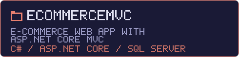
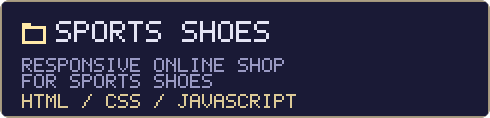

I'm a Software Engineering graduate from The Hashemite University. I like turning an idea into something people can actually click through, from the database and API behind it to the screen in front of it.

- Frontend Developer Intern at Excellence Smart Solutions (React, Next.js, React Native / Expo)
- Full-Stack Intern at Orange Coding School (ASP.NET Core MVC)
- UI/UX Design certified, so I care how things look and feel
- Open to junior full-stack, frontend and .NET roles in Amman

<table>
<tr>
<td width="50%"></td>
<td width="50%"></td>
</tr>
<tr>
<td width="50%"></td>
<td width="50%"></td>
</tr>
<tr>
<td width="50%"></td>
<td width="50%"></td>
</tr>
</table>

&nbsp;&nbsp;

